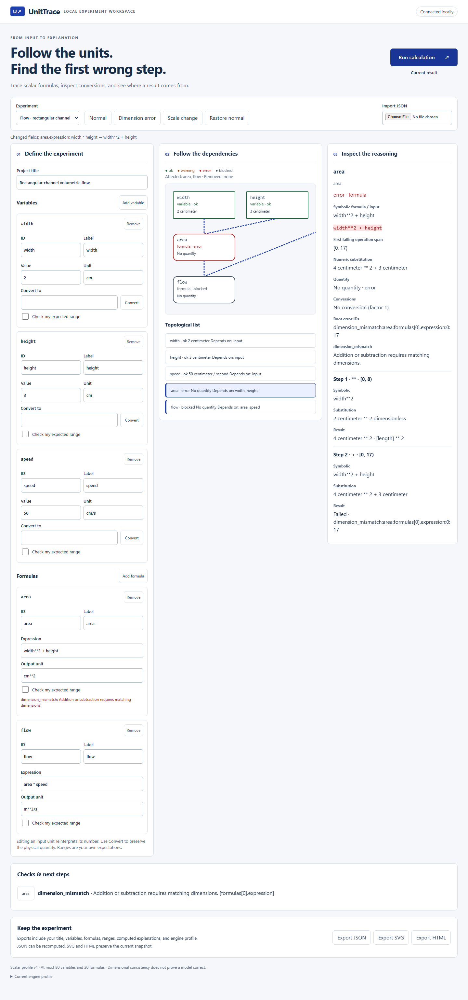

# UnitTrace

### A local workspace for tracing units through scalar formulas

**Inspect units, trace dependencies, and find the first incompatible operation. Save experiments as recomputable JSON or share their graph and explanations as offline SVG and HTML.**

English | [中文](README_ZH.md)

[Quick start](#start-locally) · [Try an experiment](#try-the-flow-experiment) · [Command line](#command-line) · [Protocol and limits](docs/schema.md)



The real Flow demo identifies the incompatible addition in `width**2 + height` and marks its downstream flow node as blocked.

## Features

- Trace formulas through a dependency graph and inspect operation spans, substitutions, dimensions, and conversion factors.
- Edit variables, formulas, and expected ranges; convert a quantity or reinterpret its input unit explicitly.
- Explore eight experiments, each with normal, dimensional-error, and scale-change variants.
- Recompute saved projects with the Python/Pint engine and export JSON, SVG, or offline HTML.

## Start locally

Use **Python 3.12**. The locally verified environment is Windows with Python 3.12.14 and Pint 0.25.2.

```powershell
py -3.12 -m venv .venv
.venv\Scripts\python -m pip install --require-hashes -r requirements.lock
.venv\Scripts\python -m pip install --require-hashes -r requirements-build.lock
.venv\Scripts\python -m pip install --no-deps --no-build-isolation .
.venv\Scripts\unit-trace serve --open
```

The command prints a `127.0.0.1` address on a random port. Keep that process running while you work; Ctrl+C closes its session. Installed commands also work outside the source directory. The browser loads its assets locally and sends calculations to the one Python/Pint engine. No account or network service is required at runtime.

## Try the flow experiment

1. Choose **Flow**, then **Dimension error** and **Run calculation**. The area node identifies `width**2 + height`; flow is blocked by that root error.
2. Change the area expression to `width * height` and run again: area is 6 cm² and flow is 0.0003 m³/s.
3. Change area's output unit from `cm**2` to `m**2`: area becomes 0.0006 m², with factor 0.0001, while flow stays the same.
4. Change speed's input unit from `cm/s` to `m/s`, keeping 50: flow becomes 0.03 m³/s. This reinterprets the physical input. Use **Convert** when you want to preserve the physical quantity instead.
5. Add your own expected range to a node. Range warnings preserve valid quantities and downstream calculations. A range that cannot be checked is explicitly reported as such.

Every edit immediately marks previous results as old and disables export until a current calculation is accepted. Delayed calculations and conversions cannot overwrite newer edits. Select graph nodes or use the keyboard-accessible topological list to inspect symbolic formulas, substitutions, quantities, dimensions, conversions and operation spans.

## Eight experiments

Each includes a normal project, one dimensional error, and a same-dimension scale change. Changed fields are displayed; **Restore normal** brings back the unmodified template. No expected ranges are preset.

| Template | Model and normal result | Simplifying assumption |
| --- | --- | --- |
| `flow` | Rectangular area × speed → 0.0003 m³/s | Uniform speed across the section |
| `density` | Mass / volume → 2500 kg/m³ | Homogeneous sample |
| `spring` | Force / extension → 98 N/m | Linear static spring response |
| `electric` | Voltage / resistance, then power → 24 W | Ideal ohmic component |
| `energy` | ½ mass × speed² → 9 J | Classical translational motion |
| `diffusion` | Displacement² / (2 × time) → 5×10⁻⁷ m²/s | One-dimensional mean-square displacement estimate |
| `concentration` | Mass / volume → 200 mg/L | Uniform mixture, additive sample volume |
| `pendulum` | 4π² length / period² → 9.869604401089358 m/s² | Ideal small-angle pendulum |

Use the assumptions above when interpreting each result. Dimensional consistency checks compatible operations; validating the physical model requires domain knowledge. Supply your own expected ranges to flag same-dimension scale changes.

## Command line

```powershell
unit-trace --version
unit-trace demo flow --variant dimension --json experiment.json
unit-trace evaluate experiment.json --json result.json --svg graph.svg --html report.html
unit-trace serve --port 0
```

`demo` writes a Project; `evaluate` always recomputes it. Existing output files require `--overwrite`. The input file and its hardlink/symlink aliases cannot be overwritten, even with that option. Each output needs its own path. Exit status: **0** clean, **1** errors/blocked nodes, **2** warnings only, **3** invalid input, limits, I/O or cancellation; priority is 3 > 1 > 2 > 0.

For an imported Bundle with the same supported schema/profile but different engine versions or definition hashes, the CLI defaults to `engine_mismatch` and exit 3. Choose `unit-trace evaluate saved.json --recompute` to explicitly compute using the current engine. This never trusts saved results or bypasses schema or input limits. The browser displays both profiles and offers the same explicit choice.

## Syntax and bounds

Formulas reference node IDs and support decimal constants, parentheses, unary `+`/`-`, `+ - * /`, and integer literal powers `**` from −12 to 12. Use `**`, not `^`; supply constants such as pi as dimensionless input variables. Calls, attributes, indexing, functions and executable expressions are excluded.

Units are case-sensitive whitelist symbols combined with `* / **` and parentheses. Examples: `cm**2`, `kg/m**3`, `m**2/s`. The symbols are:

```text
1 m cm mm um nm km s ms us min h kg g mg L mL mol mmol
A mA V mV ohm kohm N Pa kPa MPa J kJ W mW Hz rad
```

Use ASCII `um` and `cm**2`. Temperature, temperature differences, contexts, arrays, uncertainties and custom unit definitions are outside this profile. Decimal text is preserved, while calculations use finite binary64 numbers with nonzero magnitude 1e−100 through 1e100 at every step. Limits include 80 variables, 20 formulas, 128 KiB per Project, 256 KiB per HTTP body and 8 MiB per local JSON Bundle. See [the complete schema](docs/schema.md).

## Save and share

- **JSON** contains inputs, the actual engine profile and a result snapshot. Import extracts the Project and recomputes; saved quantities never become calculation inputs.
- **SVG** is a self-contained graph snapshot.
- **HTML** is an offline report with native expandable node explanations. It opens without network requests and cannot recompute. Use its companion JSON in a running service or CLI to continue editing.

Exports contain the experiment content you entered. Session tokens, machine paths and server logs are not included. The service binds only to loopback, checks Host/Origin/session headers, limits requests to four active workers, and exposes no filesystem API. [The actual profile](docs/profile.json) records Python, Pint, dependencies, whitelist version and bundled unit-definition hashes.

## Development

```powershell
.venv\Scripts\python -m unittest discover -s tests -v
.venv\Scripts\python -m pip check
.venv\Scripts\python -m pip wheel --no-deps --no-build-isolation . -w dist
```

[CONTRIBUTING](CONTRIBUTING.md) explains handwritten template expectations and testing. The included CI configuration runs Python checks on Windows. Local validation passed 75 tests and exercised real browser editing, imports, exports, keyboard controls, and a 390px layout.

Original code and templates: [MIT](LICENSE). Dependency licenses and attribution: [THIRD_PARTY_NOTICES](THIRD_PARTY_NOTICES.md).
